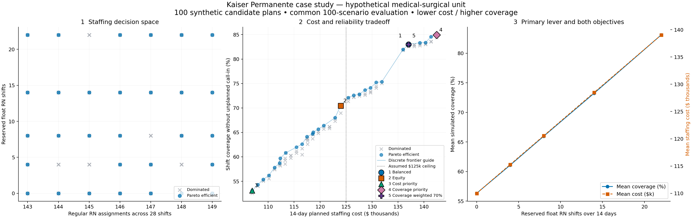

# Kaiser Permanente nurse staffing optimization engine
**Jesse Leyva — Final Project Phase 1**

A reproducible synthetic study of planned labor cost versus shift-coverage resilience for a hypothetical California medical-surgical unit. Built from the supplied *Nurse Staffing Cost and Coverage at Kaiser Permanente* proposal. This is not Kaiser operational data, a clinical staffing tool, or a claim of verified savings.

## Business problem and scope
Choose binary assignments for 22 qualified RNs and integer reserved float capacity (0–2 per shift) for 28 twelve-hour shifts across 14 days. Minimize **planned staffing cost in dollars** and maximize **percentage of 2,800 scenario-shifts covered without unplanned call-ins**. Forecast coverage, availability, rest and weekly caps remain mandatory in candidate generation. Actual scenario shortfalls require escalation rather than permission to work below necessary coverage.

Exactly **100 candidate plans** are the optimization dataset. Each is evaluated on the same **100 correlated-within-day census/absence replications**. Supporting scenario and assignment rows are not extra candidates. Plans are generated by a seeded mixed-integer roster model and reserve-allocation heuristics; the final Pareto calculation is exact within this candidate set, not globally exhaustive over every possible roster.

## Key findings
- 30 efficient plans and 70 dominated plans; skyline results exactly match an independent quadratic oracle.
- 60 candidates meet the assumed $125,000 planned-cost ceiling.
- All 100 schedules pass modeled qualifications, availability, forecast coverage, rest, weekly cap, cost and coverage recomputation checks.
- Five strict-improvement examples identify cheaper, more reliable efficient alternatives in `results/dominated_examples.csv`.

| Strategy | Plan | Regular RN shifts | Float RN shifts | OT hours | Planned cost | Coverage | Within $125k |
|---|---|---:|---:|---:|---:|---:|---|
| Balanced | P080 | 144 | 22 | 144 | $137,040 | 83.00% | No |
| Equity | P068 | 149 | 8 | 204 | $123,960 | 70.43% | Yes |
| Cost priority | P071 | 143 | 0 | 132 | $106,920 | 53.11% | Yes |
| Coverage priority | P035 | 149 | 22 | 204 | $142,440 | 84.93% | No |
| Coverage weighted 70% | P080 | 144 | 22 | 144 | $137,040 | 83.00% | No |

The balanced and 70%-coverage weighted strategies select the same plan. Different strategic rules do not guarantee different solutions. Balanced and maximum-coverage points exceed the proposed ceiling; do not present them as budget-feasible recommendations. Equity is parity between two normalized stakeholder benefits, **not nurse workload equity**. The budget is disclosed rather than filtered because Phase 1 exposes the complete tradeoff space. Phase 2 must handle feasibility and strategic constraints explicitly.



Example: replacing P050 with efficient P080 saves **$1,080** in planned staffing cost and increases modeled coverage by **0.11 percentage points** on the shared scenario bank.

## Run from a clean environment
Python 3.12 was used. From the repository root:

```bash
python -m venv .venv
# macOS/Linux
source .venv/bin/activate
# Windows alternative: .venv\Scripts\activate
python -m pip install -r requirements.txt
python -m unittest discover -s tests -v
python src/engine.py
```

Open `optimization_engine.ipynb` in VS Code or Jupyter with the environment's Python kernel, then **Restart Kernel and Run All**. Run it from the repository root so `src/engine.py` and output folders resolve. For automated execution with a new kernel:

```bash
python execute_notebook.py
# Socket-restricted environments can use a restarted in-process ipykernel:
python execute_notebook.py --in-process
```

This environment blocks external kernel sockets; the verified run used an explicitly restarted in-process ipykernel in a fresh interpreter. Standard external-kernel execution is supplied for normal local environments but was blocked here.

The notebook is supplied with executed cells, readable markdown, data inspection, comparison tables and figures. `src/engine.py` owns the reusable implementation. `execute_notebook.py` independently verifies a clean-kernel rerun and records stable CSV digests. All generated CSVs and PNGs are committed so GitHub reviewers can inspect results without executing the notebook.

## Repository layout
- `optimization_engine.ipynb`: executable analysis and strategic interpretation.
- `src/engine.py`: generator, roster MILP, validation, O(n log n) Pareto skyline, strategic rules and plots.
- `data/candidate_plans.csv`: 100 evaluated candidate plans with decisions, objectives, uncertainty and budget flags.
- `data/assignments.csv`: nurse IDs and float counts for each candidate/shift.
- `data/nurses.csv`, `shifts.csv`, `scenarios.csv`, `simulation_inputs.npz`: exact supporting inputs.
- `images/three_panel_analysis.png`: decision space, objective frontier and primary-lever comparison.
- `images/exploration.png`: distributions, relationships and correlations.
- `results/`: quality checks, strategies, group summaries, dominated examples, scalar comparison, rate sensitivity and reproducibility manifest.
- `docs/data_provenance.md`: complete AI generation specification, source links, assumptions and proposal alignment.
- `tests/test_engine.py`: edge cases and 120 seeded randomized comparisons across all objective directions.
- `requirements.txt`: tested package versions.

## Mathematical definitions
A dominates B iff cost(A) ≤ cost(B) and coverage(A) ≥ coverage(B), with at least one strict inequality. Equality in one objective still permits dominance. Efficient duplicate objective pairs are retained. Nonfinite inputs are rejected; ties are processed in groups. The algorithm sorts once then scans; `brute_pareto` is an independent O(n²) correctness oracle.

Strategies only select frontier points. Convert cost and coverage to 0–100 benefits over full-candidate min/max anchors before summing. Balanced maximizes benefit sum; equity minimizes absolute benefit gap; cost priority minimizes raw dollars; coverage priority maximizes raw coverage; custom weighted maximizes 0.3×cost benefit + 0.7×coverage benefit. Ties prefer larger balanced score, then candidate ID. Normalization anchors are sample-dependent and must be held fixed for comparisons in a run. No unique objective-space “best” or “worst” exists without a scalar preference; `scalar_comparison.csv` uses the declared balanced score.

Cost = regular hours×$60 + overtime hours×$90 + reserved float hours×$110. Regular hours are capped at 36 per nurse/week; hours 36–48 use the modeled premium rate. Float reservations are paid for the full shift. These are proposal assumptions, not Kaiser pay scales or a full wage-law model. Normal intervals use scenario-level means, not 2,800 falsely independent shifts.

## Limits and sources
This phase does not implement an agent, constraint filtering, or clinical recommendations. Budget flags are information, not a feasibility filter. Guaranteed available floats, fixed Day/Night cohorts, simplified acuity, full-shift break relief, sampled rosters, a shared scenario bank and omitted emergency call-in costs limit conclusions. Monte Carlo intervals may overlap; close rankings are not proof of a material difference. Independent future-scenario evaluation is needed before recommending deployment.

HCAI documentation was reviewed but **no facility-specific HCAI data calibrated the synthetic occupancy or unit size**. This is an explicit limitation relative to the proposal's intended contextual calibration. Public sources reviewed November 15, 2026:
- [CDPH AFL 07-26](https://www.cdph.ca.gov/Programs/CHCQ/LCP/Pages/AFL-07-26.aspx): historical medical-surgical licensed-nurse ratio and acuity context; the RN-only assumption is a project choice.
- [AHRQ Nursing and Patient Safety](https://psnet.ahrq.gov/primer/nursing-and-patient-safety): staffing requires more than headcount.
- [HCAI Hospital Utilization](https://hcai.ca.gov/data/healthcare-utilization/hospital-utilization/): facility-level annual reporting scope.

Full source roles, assumptions, exact prompts and generation seeds are in `docs/data_provenance.md`. No personal proposal PDF, real patient data or employee records are included.
